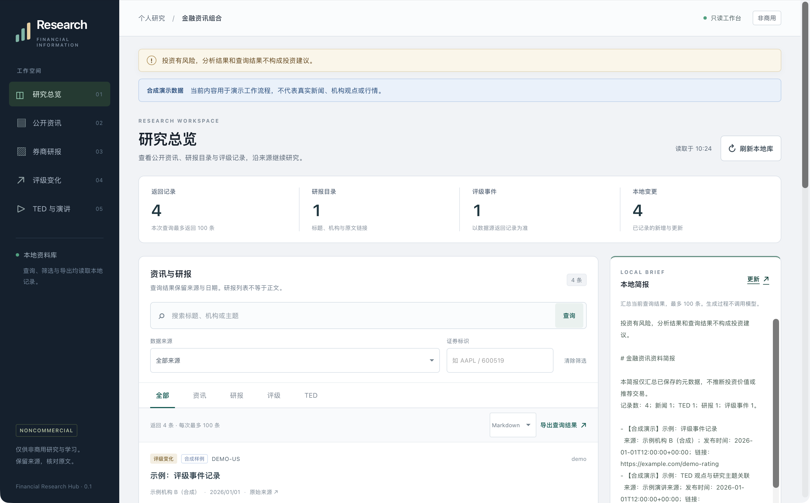

# Financial Research Hub

**投资有风险，分析结果和查询结果不构成投资建议。**

Investing involves risk. Analysis and query results do not constitute investment advice.

**Noncommercial use only.** The original software and documentation use the custom [Financial Research Hub Noncommercial License 1.0](LICENSE). You may inspect the source, conduct noncommercial research, modify the project and share it under those terms. Commercial use requires separate written permission from the relevant copyright holders. This is a source-available project; it does not claim an OSI-approved open-source license.

Bring public news, TED entries, broker-report metadata and overseas analyst-rating events into one local research workspace. Preserve sources and dates, compare new and updated records, and export material with its risk notice for personal research.

The bundled interface currently uses Simplified Chinese. Repository documentation is English-first. The required Chinese risk notice remains unchanged in the interface and output contract.



## Features

| Information | Initial scope |
| --- | --- |
| Public news and TED | Titles, links, publication dates and short summaries from fixed public RSS/Atom sources |
| Chinese broker research | Eastmoney metadata for stock, industry, macro, strategy and broker morning reports |
| Overseas analyst ratings | Yahoo-aggregated rating events through the optional yfinance adapter |
| Change history | Local SQLite snapshots that distinguish first observation, new records, updates and unchanged records |
| Search and briefs | Filters for type, source, symbol and keywords, plus source-linked metadata briefs |
| Knowledge-base exports | JSON, CSV, Markdown and retrieval chunks that retain risk notices, sources and demo labels |

Available report fields depend on the selected interface. A report-list record does not contain the report's full text. A rating event does not contain an investment bank's complete reasoning. Programs that share Eastmoney or Yahoo still share the same direct data provider.

## Quick start with synthetic data

Use Python 3.11 or later. The base application uses the Python standard library and does not require a model account or a data API key.

Clone the repository and start the demo:

```sh
git clone https://github.com/alysaallena-sys/financial-research-hub.git
cd financial-research-hub
python -m finance_research_hub --db .local/demo.sqlite3 demo
python -m finance_research_hub --db .local/demo.sqlite3 serve --demo --port 8765
```

Open the [local workspace](http://127.0.0.1:8765). All demo entries are synthetic. They do not represent actual news, institutional opinions or current market data.

The server binds to the local loopback address. It does not publish the page to the internet. These commands keep demo records in `.local/demo.sqlite3`, separate from the default `.local/research.sqlite3`. Press `Ctrl+C` in the server's terminal to stop it.

## Search, briefs and exports

```sh
python -m finance_research_hub --db .local/demo.sqlite3 query --kind research
python -m finance_research_hub --db .local/demo.sqlite3 brief
python -m finance_research_hub --db .local/demo.sqlite3 export --format markdown
python -m finance_research_hub --db .local/demo.sqlite3 export --format csv
python -m finance_research_hub --db .local/demo.sqlite3 export --format json
python -m finance_research_hub --db .local/demo.sqlite3 export --format jsonl
```

Use `python -m finance_research_hub --help` and each subcommand's help for the current options. Omitting `--db` selects `.local/research.sqlite3`. JSON includes records and retrieval chunks with notices; JSONL emits one chunk per line. Empty JSONL and CSV exports still contain one `record_type: notice` entry. It is a notice, not a research item; importers must distinguish the types. Search and export read the local database without starting collection, model calls or PDF downloads.

## Optional live metadata collection

Collection requires an explicit `--live` flag. Review the [source notes](docs/SOURCES.md) before choosing a source that permits your intended use. These examples show entry points. The bounded source checks described below do not establish complete or ongoing coverage:

```sh
python -m finance_research_hub collect --source bbc --live
python -m finance_research_hub collect --source guardian --live
python -m finance_research_hub collect --source ted --live
python -m finance_research_hub collect --source eastmoney --symbol 600519 --live
```

Report types are `stock`, `industry`, `strategy`, `macro` and `morning`. Use `--symbol` for a stock and `--industry` for an industry. Set `--begin` and `--end` to make the date range explicit. Bound the request with `--max-pages` and `--page-size`. The default range is the past seven days, with a hard limit of 10 pages and 100 entries per page. Results retain coverage and truncation information.

```sh
python -m finance_research_hub collect --source eastmoney --report-type macro --begin 2026-01-01 --end 2026-01-07 --max-pages 1 --page-size 20 --live
```

The fixed dates above are parameter examples. They do not establish complete data for that period.

Install the optional dependency explicitly before using the overseas ratings adapter:

```sh
python -m pip install '.[ratings]'
python -m finance_research_hub collect --source yahoo --symbol AAPL --live
```

Dependency installation connects to a package source. Live collection connects to the selected provider. Requests have timeout, pagination or quantity limits. Read the returned coverage information; a bounded page set does not establish a complete history.

If Python's CA configuration is incomplete and the system `curl` can verify the source certificate, select the system transport explicitly:

```sh
python -m finance_research_hub collect --source bbc --transport curl --live
```

This option applies only to RSS and Eastmoney adapters. It keeps HTTPS certificate validation and checks each redirect against the source allowlist. It does not disable certificate checks or change system trust settings. yfinance uses its own network implementation and rejects this override.

Bounded checks on 2026-11-06 retrieved BBC and Guardian feed metadata and one page of Eastmoney report metadata. The official TED redirect chain was checked, but the final network request failed; TED collection remains unverified. The optional overseas ratings dependency has not received runtime acceptance. See the [acceptance scope](docs/ACCEPTANCE.md).

The project does not bundle paid report databases, collect paid media, download report PDFs, execute trades, or automatically run models, notifications or scheduled jobs. Preserve a source-access failure as a failure. Do not bypass source restrictions.

## Editor, agent and knowledge-base integration

**Every integration that uses this project to build a knowledge base must make the editor visibly display this exact Chinese notice with query and analysis results:**

> 投资有风险，分析结果和查询结果不构成投资建议。

Retain the same notice in every record, retrieval chunk and export. Hidden metadata, a license page alone, or a one-time dialog does not satisfy the integration conditions.

- Machine-readable contract: [integrations/editor-contract.json](integrations/editor-contract.json)
- Integration and acceptance steps: [integrations/editor-instructions.md](integrations/editor-instructions.md)
- Project agent rules: [AGENTS.md](AGENTS.md)

The bundled page, CLI and export paths implement notice retention. This repository cannot technically force an unrelated editor to follow the rules. External integrators must check the final display and must not claim compliance before that check passes.

## Data and privacy

Keep local databases, logs, credentials, live collection results and acquired original reports out of the public repository. `.gitignore` excludes common local state; still inspect the actual file list before publishing. The public repository contains code, documentation, tests and clearly labeled synthetic examples.

Distinguish the original publishing institution from the direct data provider. Retain publication time, retrieval time and coverage status. Public access does not by itself authorize bulk storage or redistribution. A software license does not replace the terms governing data, articles or research reports.

## Validation and contributions

```sh
python -B -m unittest discover -s tests -v
```

Offline tests use synthetic inputs without calling live financial interfaces, invoking models or downloading reports. GitHub Actions runs the same test entry point with read-only repository permissions. A passing workflow does not establish that a third-party interface is currently available.

Read the [acceptance scope](docs/ACCEPTANCE.md), [contribution rules](CONTRIBUTING.md) and [security notes](SECURITY.md). A new source needs documented coverage, rights boundaries, failure behavior and notice-retention checks.

## License and risk

[LICENSE](LICENSE) and [NOTICE](NOTICE) govern the project's original software and documentation. Third-party packages and data retain their own terms. The project does not guarantee complete, accurate or timely data, does not guarantee returns, and does not provide investment, legal or tax advice.

